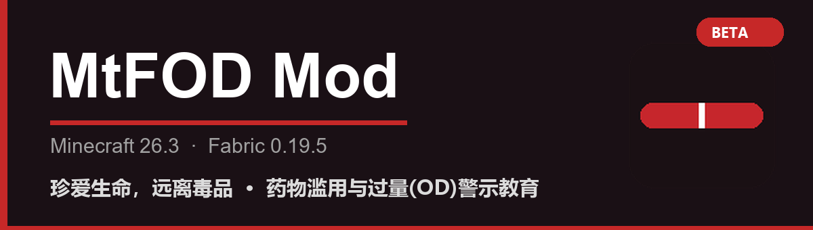

<p align="center">
  
</p>

<p align="center">
  
  
  
  
  
  
  <a href="https://github.com/RainSnowDream/MtF-OD-Mod/releases"></a>
</p>

<h2 align="center">A Minecraft Fabric / NeoForge mod that warns about drug abuse and overdose (OD)</h2>

<p align="center"><i>Cherish life, stay away from drugs. For public education only; not medical advice.</i></p>

<p align="center"><a href="README.md" target="_blank">中文</a> | <a href="README.en.md" target="_blank">English</a></p>

---

## 📥 Download

Grab the `.jar` for your loader from **[Releases](https://github.com/RainSnowDream/MtF-OD-Mod/releases)**:

| Loader | File |
| --- | --- |
| Fabric | `mtfodmod-<version>+fabric+26.3.jar` |
| NeoForge | `mtfodmod-<version>+neoforge+26.3.jar` |

## 📖 About

**MtFOD Mod** simulates the real pharmacological effects and harms of prescription drugs commonly abused in China, so players can feel the consequences of drug abuse — especially the lethality of **overdose (OD)**.

> ⚠️ **Disclaimer**: This mod is for public-education purposes only. It does not provide any dosing advice and should not be used to obtain real drug information. If you have a substance-use problem, please seek professional help.

## 💊 Items

| Icon | Item | Simulated effects | Type |
|:---:|---|---|:---:|
|  | **Pregabalin Capsule** | Sedation, dizziness, ataxia, hangover | Abuse warning |
|  | **Dextromethorphan** | Dissociation, hallucinations, tachycardia, serotonin syndrome | Abuse warning |
|  | **Amantadine HCl** | Strong stimulation, hallucinations, psychosis-like symptoms, cardiotoxicity | Abuse warning |
|  | **Gabapentin Capsule** | Sedation, dizziness, ataxia, hangover | Abuse warning |
|  | **Yumei Tablet** (DXM + guaifenesin) | Dissociation, hallucinations, nausea, toxicity | Abuse warning |
|  | **Estradiol Valerate** | Hormone replacement therapy (HRT) | Positive |
|  | **Androcur 50mg** (cyproterone acetate) | Anti-androgen (HRT) | Positive |

## ⚙️ Mechanics

- **Phased effects**: stacked effects with different durations approximate "initial rush → peak dissociation / ataxia → hangover".
- **Visual hallucination**: hallucinogenic items (dextromethorphan / yumei / amantadine) apply "darkness pulses".
- **Auditory hallucination**: while hallucinating, the vanilla creepy cave ambience (`ambient.cave`) plays at random positions.
- **Obtaining**:
  - Creative "Food & Drinks" tab;
  - Survival: the **Cleric** sells all items (pharmacy trades).
- **Clearing**: drink **milk** to clear all status effects.
- **Advancement**: "First OD" — triggered on first use of an abused drug.

## 📥 Installation

### Fabric

1. Install **Fabric Loader 0.19.5** (Minecraft **26.3**).
2. Put [Fabric API](https://modrinth.com/mod/fabric-api) in `mods/`.
3. Put the Fabric `.jar` in `mods/`.
4. Launch the game.

### NeoForge

1. Install **NeoForge 26.3.0.95** (Minecraft **26.3**).
2. Put the NeoForge `.jar` in `mods/`.
3. Launch the game.

## 🔧 Building

Requires **JDK 25**.

```bash
# Fabric (repo root)
./gradlew build          # macOS / Linux
gradlew.bat build        # Windows

# NeoForge (neoforge/)
cd neoforge
./gradlew build
```

Outputs:
- Fabric: `build/libs/mtfodmod-0.1.0-beta+fabric+26.3.jar`
- NeoForge: `neoforge/build/libs/mtfodmod-0.1.0-beta+neoforge+26.3.jar`

## 🧩 Environment

| Item | Fabric | NeoForge |
| --- | --- | --- |
| Mod version | `0.1.0-beta+fabric+26.3` | `0.1.0-beta+neoforge+26.3` |
| Minecraft | 26.3 | 26.3 |
| Loader | Fabric Loader 0.19.5 | NeoForge 26.3.0.95 |
| Dependency | Fabric API 0.163.0+26.3 | — |
| Java | 25 | 25 |

## 🤝 Contributing

Feel free to open an [Issue](https://github.com/RainSnowDream/MtF-OD-Mod/issues/new/choose) or a PR. See [CONTRIBUTING.md](CONTRIBUTING.md).

## 📜 License

Released under **CC0-1.0**.
